# UT2.3 Gestión de los recursos de un SO: La memoria

## La memoria

### Memoria principal interna

La **memoria interna principal** son chips conectados a la placa base principal de cualquier ordenador o computadora. Son dispositivos caros y rápidos que almacenan información para la operaciones y el procesamiento de los datos de la CPU, gráfica y el sistema operativo.

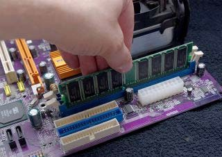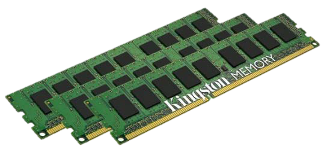

- La memoria **RAM** se utiliza para el almacenamiento y la recuperación inmediata de datos. Es rápida y temporal. Guarda los datos de los programas mientras se están usando. Cuando apagamos el ordenador, su contenido se borra.

- La memoria **ROM** hace referencia a un pequeño espacio de memoria que contiene información que no cambia, como las instrucciones básicas para arrancar el sistema (el firmware o BIOS).

¿Cuánta **memoria RAM** requieren las siguientes aplicaciones?

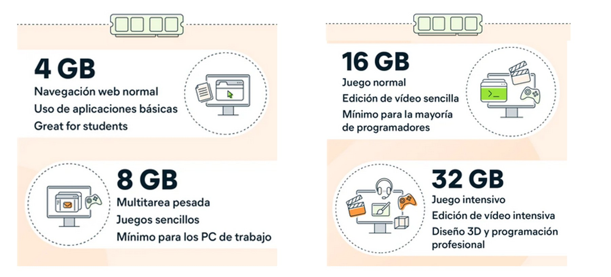

### Esquema de memorias


## Gestión de la memoria RAM


```note
El sistema operativo se encarga de gestionar y repartir la memoria entre los distintos procesos de programas o apps en ejecución.
```

La gestión de memoria tiene como objetivos principales:

-   Proporcionar memoria a cada proceso cuando la necesita y liberarla cuando termina.
-   Evitar que un proceso use la memoria de otro y proteger la memoria de accesos no autorizados.
-   Conseguir que el equipo funcione lo más rápido posible.


El sistema operativo utiliza diferentes técnicas para organizar la memoria RAM y repartirla entre los procesos en ejecución. 

Dos de estas técnicas son el **particionado** y la **paginación**.  

### Particionado y paginación

-   **Particionado:** Consiste en dividir la memoria RAM en varias zonas llamadas **particiones**. A cada proceso se le asigna una partición donde se almacena mientras se ejecuta. Las particiones pueden tener distintos tamaños, pero este método puede provocar huecos, lo que se conoce como **fragmentación**.

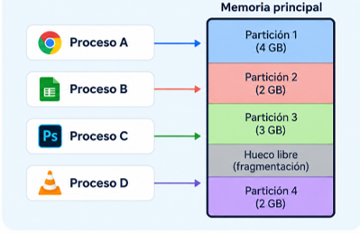

-   **Paginación**: Para aprovechar mejor la memoria, se divide en partes más pequeñas llamadas **marcos**. Los procesos también se dividen en trozos del mismo tamaño llamadas **páginas**. De este modo, cada página del proceso de un programa se coloca en cualquier marco libre de la memoria sin necesidad de estar juntas. Así se aprovecha mejor la memoria disponible.

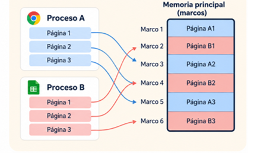

### Fragmentación de la memoria

El sistema operativo carga continuamente procesos en la memoria RAM y libera el espacio que ocupan cuando finalizan.

Con el tiempo, al cargar y eliminar procesos, pueden aparecer espacios libres que no se aprovechan correctamente, aunque todavía exista memoria disponible. Este problema se conoce como fragmentación de memoria y puede dificultar la asignación de memoria a nuevos procesos.

```notes
La **fragmentación** es el proceso por el cual en la memoria principal (o disco) quedan espacios o huecos sin utilizar para algún proceso o dato a lo largo del tiempo, degradando el rendimiento en dichos dispositivos.
```

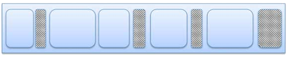

En la memoria producen dos tipos de fragmentación:

-   La **fragmentación interna** se produce cuando a un proceso se le asigna más memoria de la que realmente necesita. El espacio sobrante queda desaprovechado dentro del bloque.

    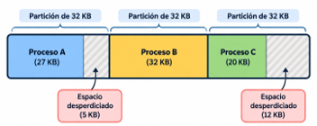

-   La **fragmentación externa** se produce cuando la memoria libre queda dividida en pequeños huecos separados. Aunque haya suficiente memoria libre en total, puede que no exista un espacio contiguo suficientemente grande para cargar un nuevo proceso.

    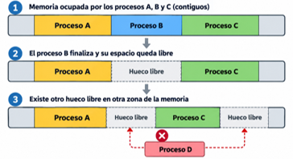


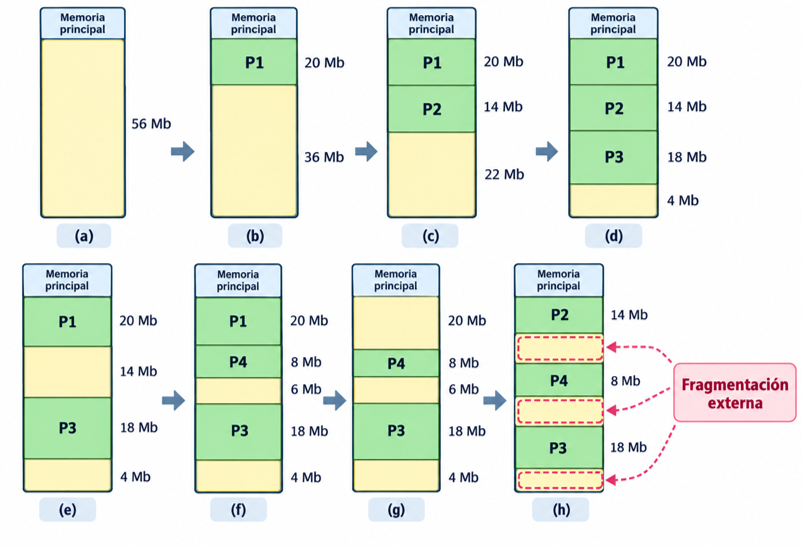


### Particiones 

El administrador divide la memoria en particiones de varios tamaños antes del inicio de la ejecución de los programas. 

Cuando llega un nuevo proceso, el planificador lo ubica en la partición con el tamaño más adecuado y, cuando un proceso acaba, su partición queda libre para un nuevo uso.

Las particiones fijas producen principalmente **fragmentación interna**. Las particiones variables producen **fragmentación externa**.

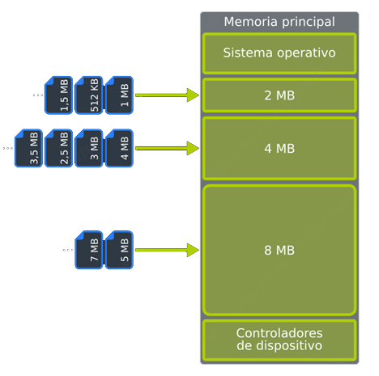 


### Paginación

Se divide la memoria en unidades pequeñas y fijas llamadas **páginas**, y se divide cada proceso en unidades del mismo tamaño llamadas **marcos**. 

Cada marco se asigna a una página libre en memoria (que no tiene por qué ser contigua), y se utiliza una tabla para llevar el control de las páginas y los marcos. 

Esta técnica evita la *fragmentación externa*, pero puede generar sobrecarga por el manejo de las tablas y los cambios de página. El último marco genera **fragmentación interna**.

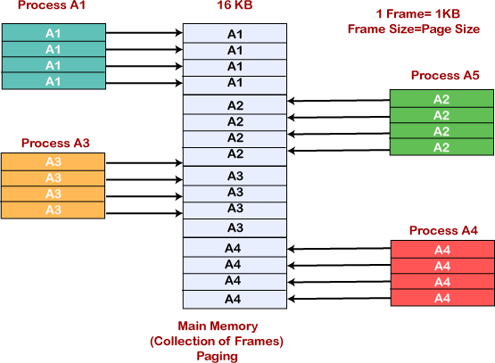


- A modo de ejemplo, imagina que el proceso que queremos cargar en memoria lo representáramos con el zumo contenido en la botella de la siguiente imagen. Por su parte, la memoria donde pretendemos almacenarlo estaría representada por los vasos. Cada vaso, sería el equivalente a un marco de página de la memoria.


- Así, cuando carguemos el proceso en memoria, cada página (cantidad de zumo del tamaño de un vaso) se ubicará en un marco de página diferente. Gracias a este planteamiento, se acaba con la fragmentación externa, y la fragmentación interna quedará reducida al último marco de página asignado a cada proceso.


## Memoria virtual

La memoria RAM es limitada y puede resultar insuficiente cuando ejecutamos varios programas o aplicaciones al mismo tiempo. Además, en algunos dispositivos si una app o programa lleva tiempo sin usarse se envía a disco para ahorrar batería.

```note
La **memoria virtual** es una técnica de gestión de la memoria que permite que un sistema operativo disponga, tanto para el software como para sí mismo, de mayor cantidad de memoria que la que está disponible físicamente.
```

De esta forma:
- Solo las partes de los programas que se necesitan se mantienen en la memoria RAM.
- Otras partes pueden permanecer temporalmente en el disco de almacenamiento.
- El sistema operativo gestiona qué partes deben estar en RAM en cada momento.

👉 Ejemplo: si tenemos abiertos un navegador, un editor de texto y un reproductor multimedia, el sistema operativo puede mantener en RAM las partes que se están utilizando y dejar otras fuera de ella.

### Espacio de intercambio

```note
Se denomina **espacio de intercambio**, también conocido como **swap**, a la zona de un disco de almacenamiento secundario utilizada para almacenar procesos que actualmente no están en ejecución y así dejar memoria RAM para los procesos que sí lo están.
```

El inconveniente de esta técnica es la importante **bajada de rendimiento** que supone el uso de discos de almacenamiento secundaria, mucho más lentos que la memoria y el uso de direcciones virtuales y direcciones físicas reales que necesitarán el uso de una tabla de conversión intermedia que veremos más adelante.

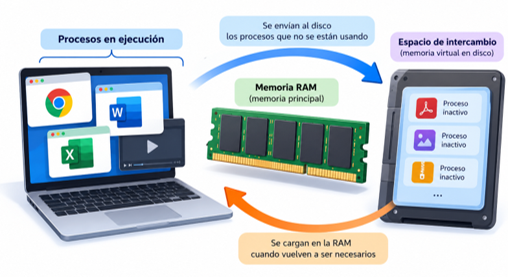


> 👉 Cuando se cargan muchos procesos a la vez el equipo se ralentiza puesto que tiene que pasar mucha información del disco a memoria RAM y los sistemas de almacenamiento secundario son mucho más lentos que la memoria.

### Memoria en dispositivos móviles

En los teléfonos móviles o tablets, la gestión de la memoria RAM es especialmente importante, ya que deben aprovechar sus recursos y reducir el consumo de batería.

Sistemas operativos como Android e iOS utilizan distintas técnicas para gestionar las aplicaciones que permanecen en segundo plano:
- Suspender aplicaciones que no se están utilizando para reducir el consumo de CPU y batería.
- Comprimir datos en memoria para aprovechar mejor la RAM disponible.
- Cerrar aplicaciones en segundo plano cuando necesitan liberar memoria para otras tareas.

En algunos dispositivos también se utiliza espacio del almacenamiento interno como memoria de intercambio.


## Gestión de la memoria virtual 

### Paginación  

La **paginación** es una técnica que consiste en dividir la memoria interna o RAM en particiones iguales llamadas frames o marcos, y los procesos en partes del mismo tamaño denominadas **páginas**. 

-   Es un esquema de gestión de memoria en el que la asignación de memoria no es contigua.
-   El espacio de direcciones virtuales de un proceso está dividido en bloques de tamaño fijo llamados **páginas**.
-   Se produce algo de fragmentación interna.
-   La memoria física se divide en **marcos de página**.

Se utiliza habitualmente para la gestión de la memoria virtual gracias a su facilidad para llevar páginas no usadas al **almacenamiento secundario (disco).**

El esquema contará por tanto con:
- El espacio de direcciones virtuales divididas en bloques de tamaño fijo llamados **páginas**.
- La memoria física dividida en bloques fijos llamados **marcos de página** o frames.

Mediante una **tabla de páginas**, la CPU asigna las direcciones físicas de los **frames** a las **páginas** en las que se ha dividido el programa. 

> De la traducción y asignación de direcciones en la paginación se encarga el **MMU** (Unidad de administración de memoria)

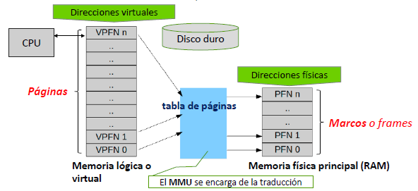

Los procesos de los distintos programas se van cargando en la memoria RAM en sus respectivos **marcos** hasta que la memoria física se **llene**. En ese momento los procesos que no quepan en la memoria física y no estén en ejecución en ese momento **se moverán al disco** y se borrará su entrada de la tabla de páginas. 


Si al buscar una página en la tabla de páginas no se encuentra, se producirá un **fallo de página**. Ello significa que no estaba cargada en la RAM y se solicitará recuperar dicho dato del disco añadiéndose por tanto a la tabla una nueva entrada y borrando una anterior.  

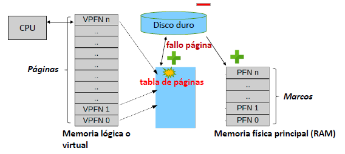

En el siguiente ejemplo muestra cómo se cargan las páginas de los procesos A, B y C en la memoria. Después, se libera el espacio ocupado por B y se carga el proceso D, cuyas páginas ocupan **marcos no consecutivos**, mostrando que la paginación permite distribuir un proceso en distintas zonas de la memoria.

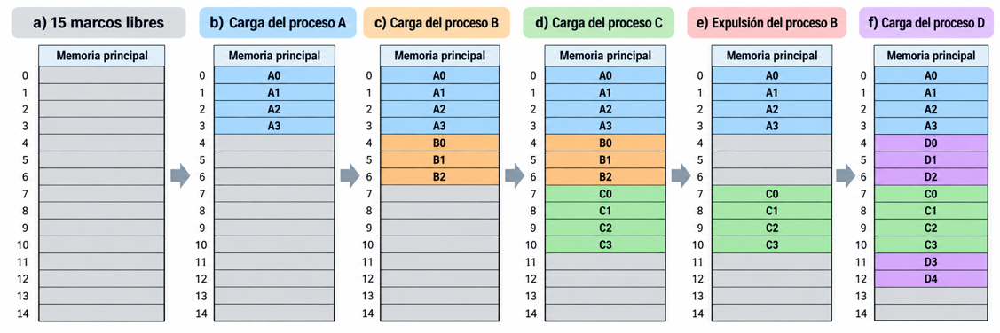


### Rendimiento e hiperpaginación

Si el sistema no está correctamente ajustado se puede producir un fenómeno llamado **hiperpaginación o thrashing**. Dicho proceso sucede cuando un proceso o programa genera fallos de página frecuentemente y el sistema pasa la mayor parte del tiempo intercambiando información entre la RAM y el almacenamiento, degradando el rendimiento del sistema. 

Para reducir este problema podemos:
- Cerrar programas que no sean necesarios.
- Reducir el número de procesos que consumen memoria (reducir la multiprogramación)
- Ampliar la memoria RAM del equipo, si es posible.

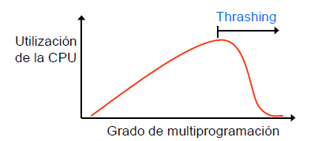

El **tamaño de las páginas** es otra consideración importante de cara al **rendimiento** de la técnica de paginación:

- Página pequeña > se requieren más páginas por proceso > tablas más grandes > menor fragmentación interna.
- Páginas grandes > se requieren menos páginas por proceso > tablas pequeñas > mayor fragmentación interna.

Por tanto, no existe un tamaño de página ideal para todas las situaciones. Su elección supone un equilibrio entre rendimiento y aprovechamiento de memoria.


### Técnica de swapping

El espacio de intercambio o swap es una zona del almacenamiento secundario que el sistema operativo puede utilizar para guardar temporalmente páginas de memoria y liberar espacio en la RAM. Cuando un proceso vuelve a necesitar una página almacenada en swap, el sistema debe recuperarla y cargarla de nuevo en la RAM.

Este intercambio permite gestionar mejor una cantidad limitada de memoria física, aunque el acceso al almacenamiento secundario es más lento que el acceso a la RAM.

**Swap en Sistemas Linux o Windows**

- En Linux, el espacio swap puede configurarse mediante una partición swap o un archivo de intercambio swap.
- En Windows, se utiliza principalmente un archivo de paginación (pagefile.sys), el cual cumple una función relacionada con la gestión de la memoria virtual.

👉 Lo veremos con más detalle en la unidad posterior.


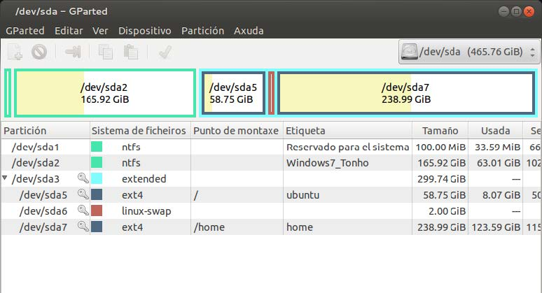

   Partición de espacio swap dedicado en un SO Linux.

| **Situación** | **Qué hace el sistema** | **Resultado** |
|---|---|---|
| Programa (proceso) o pestaña activa | Se mantiene en **RAM**. | Respuesta inmediata. |
| Programa (proceso) o pestaña inactiva | Algunas páginas de memoria pueden trasladarse al **disco (swap)**. | Libera RAM, pero puede tardar más en responder cuando vuelve a utilizarse. |
| Sistema con poca RAM | Utiliza más el **espacio de intercambio** del disco. | El equipo puede funcionar más lento. |
| Portátil o móvil sin uso prolongado | Puede suspender aplicaciones, reducir su actividad o cerrarlas para liberar recursos. | Reduce el consumo de batería y optimiza los recursos. |

